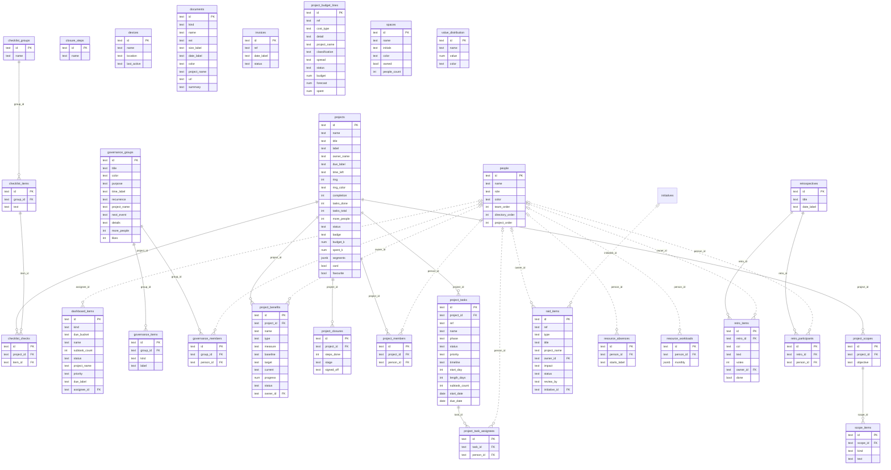
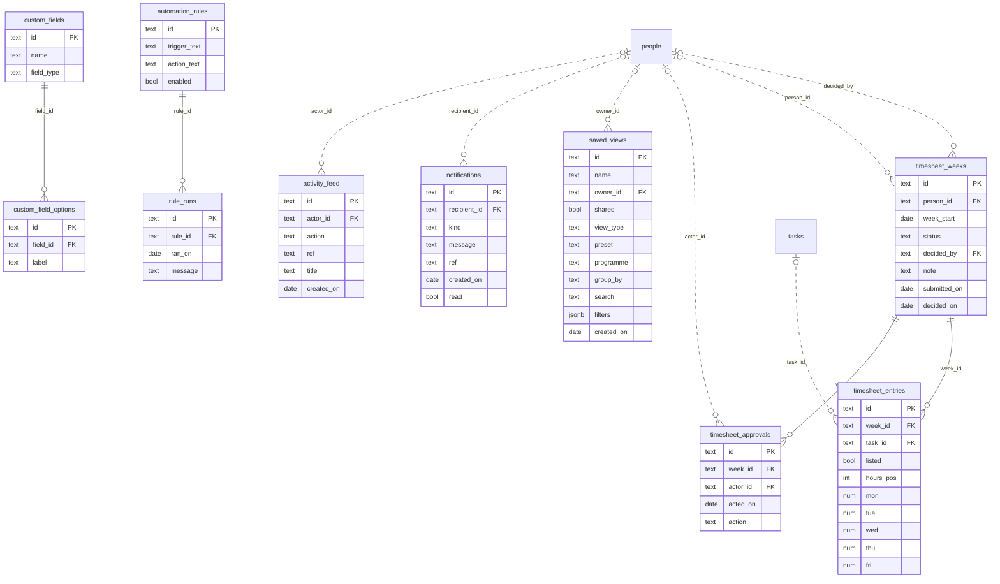

# Database relationship diagrams

Generated from the table declarations in the app (`node scripts/db/gen.js`). A solid line is an enforced parent-child key; a dotted line is a soft reference. See `docs/database.md` for the design.

### Platform

```mermaid
erDiagram
  audit_log {
    text id PK
    text at
    text who
    text kind
    text text
  }
  budget_caps {
    text id PK
    text year
    num cap
  }
  import_runs {
    text id PK
    text at
    text who
    text target
    text source
    int row_count
    int skipped
    text initiative_id FK
    jsonb task_ids
    jsonb initiative_ids
    jsonb measure_snapshots
    text summary
  }
  initiative_role_demand {
    text id PK
    text initiative_id FK
    text role_id FK
    num fte
  }
  paused_initiatives {
    text id PK
    text initiative_id FK
    text scenario_id FK
    date paused_on
  }
  product_features {
    text id PK
    text area FK
    text feature
    text class
    text coverage
    text go
    text description
    text vendors
    text roadmap_item_id FK
  }
  product_import_samples {
    text id PK
    text file_name
    text content
  }
  product_panel_findings {
    text id PK
    text text
  }
  product_panel_lists {
    text id PK
    text person_id FK
    text kind
    text text
  }
  product_panel_people {
    text id PK
    text role
    text color
    text lens
    text quote
  }
  product_panel_picks {
    text id PK
    text person_id FK
    text item_id FK
  }
  product_roadmap_areas {
    text id PK
    text color
  }
  product_roadmap_horizons {
    text id PK
    text name
    text description
  }
  product_roadmap_items {
    text id PK
    text title
    text area FK
    text horizon FK
    text status
    text go
    int votes
    jsonb asked_by
    jsonb refs
    text why
    text what
    int collab
  }
  product_shipped_areas {
    text id PK
    text name
    text icon
  }
  product_shipped_items {
    text id PK
    text area_id FK
    text name
    text go
  }
  product_vendors {
    text id PK
    text name
    text area
    text known_for
    text lesson
  }
  roadmap_suggestions {
    text id PK
    text title
    text area FK
    text horizon FK
    text status
    text go
    int votes
    jsonb asked_by
    jsonb refs
    text why
    text what
    int collab
  }
  roadmap_votes {
    text id PK
    text item_id
    text person_id FK
  }
  role_people {
    text id PK
    text person_id FK
    text role_id FK
    num share
  }
  roles {
    text id PK
    text name
    num extra_fte
    int change_quarter
    num extra_fte_after
  }
  scenario_caps {
    text id PK
    text scenario_id FK
    text year
    num cap
  }
  scenario_changes {
    text id PK
    text scenario_id FK
    text initiative_id FK
    int leave_out
    int shift_quarters
    num cost
  }
  scenarios {
    text id PK
    text name
    text description
    text created_by FK
    date created_on
    date applied_on
    text applied_by FK
    text applied_decision_id FK
    int applied_changes
  }
  initiatives |o..o{ import_runs : "initiative_id"
  initiatives |o..o{ initiative_role_demand : "initiative_id"
  roles ||--o{ initiative_role_demand : "role_id"
  initiatives |o..o{ paused_initiatives : "initiative_id"
  scenarios |o..o{ paused_initiatives : "scenario_id"
  product_roadmap_areas |o..o{ product_features : "area"
  product_roadmap_items |o..o{ product_features : "roadmap_item_id"
  product_panel_people ||--o{ product_panel_lists : "person_id"
  product_panel_people ||--o{ product_panel_picks : "person_id"
  product_roadmap_items |o..o{ product_panel_picks : "item_id"
  product_roadmap_areas |o..o{ product_roadmap_items : "area"
  product_roadmap_horizons |o..o{ product_roadmap_items : "horizon"
  product_shipped_areas ||--o{ product_shipped_items : "area_id"
  product_roadmap_areas |o..o{ roadmap_suggestions : "area"
  product_roadmap_horizons |o..o{ roadmap_suggestions : "horizon"
  people |o..o{ roadmap_votes : "person_id"
  people |o..o{ role_people : "person_id"
  roles ||--o{ role_people : "role_id"
  scenarios ||--o{ scenario_caps : "scenario_id"
  scenarios ||--o{ scenario_changes : "scenario_id"
  initiatives |o..o{ scenario_changes : "initiative_id"
  people |o..o{ scenarios : "created_by"
  people |o..o{ scenarios : "applied_by"
  decisions |o..o{ scenarios : "applied_decision_id"
```

### Portfolio

```mermaid
erDiagram
  actions {
    text id PK
    text title
    text owner_id FK
    date due_date
    text status
    text source
    date created_on
  }
  activity {
    text id PK
    text ref
    text actor_id FK
    date happened_on
    text what
  }
  baselines {
    text id PK
    text initiative_id FK
    int version
    int start_q
    int end_q
    num budget
    date set_on
    text reason
    text set_by FK
    text change_request_id FK
  }
  benefit_values {
    text id PK
    text benefit_id FK
    int quarter
    num planned
    num realised
  }
  benefits {
    text id PK
    text initiative_id FK
    text name
    text kind
    text owner_id FK
    text measure_id FK
    text unit
  }
  change_requests {
    text id PK
    text initiative_id FK
    text requested_by FK
    date requested_on
    jsonb changes
    int new_end_q
    num new_budget
    text new_scope
    text reason
    text impact
    text approver_id FK
    text status
    int old_end_q
    num old_budget
    text old_scope
    text decided_by FK
    date decided_on
    text decision_comment
  }
  comments {
    text id PK
    text ref
    text author_id FK
    date posted_on
    text body
  }
  decisions {
    text id PK
    text title
    text forum
    text about_ref
    text proposed_by FK
    text status
    int from_gate
    text decided_by FK
    date decided_on
    text rationale
  }
  finance_months {
    text id PK
    text initiative_id FK
    int month
    num budget
    num actual
    num forecast
  }
  gate_approvers {
    text id PK
    text stage_id FK
    text person_id FK
  }
  gate_checks {
    text id PK
    text gate_status_id FK
    text criterion
    bool met
    text explanation
  }
  gate_criteria {
    text id PK
    text stage_id FK
    text text
  }
  gate_log {
    text id PK
    text initiative_id FK
    text to_stage FK
    text decided_by FK
    date decided_on
    text comment
    jsonb votes
  }
  gate_status {
    text id PK
    text initiative_id FK
    text stage FK
    date last_rejected_on
    jsonb last_rejected_by
  }
  gate_votes {
    text id PK
    text gate_status_id FK
    text voter_id FK
    text decision
    text comment
    date voted_on
  }
  initiative_dependencies {
    text id PK
    text initiative_id FK
    text depends_on_id FK
  }
  initiative_finance {
    text id PK
    text initiative_id FK
    num capex_pct
    int months
  }
  initiative_followers {
    text id PK
    text initiative_id FK
    text person_id FK
  }
  initiative_measures {
    text id PK
    text initiative_id FK
    text measure_id FK
    num impact
  }
  initiative_objectives {
    text id PK
    text initiative_id FK
    text objective_id FK
  }
  initiatives {
    text id PK
    text name
    text description
    text perspective_id FK
    text programme_id FK
    text stage FK
    text status
    text owner_id FK
    int start_q
    int end_q
    int baseline_start_q
    int baseline_end_q
    num budget
    num spent
    num forecast
    num value
    num effort
    text risk
    text project_id FK
  }
  milestones {
    text id PK
    text initiative_id FK
    int quarter
  }
  programmes {
    text id PK
    text name
    text lead_id FK
    text color
    text description
  }
  purchase_orders {
    text id PK
    text initiative_id FK
    text ref
    text description
    text supplier
    num amount
    date raised_on
  }
  request_objectives {
    text id PK
    text request_id FK
    text objective_id FK
  }
  requests {
    text id PK
    text name
    text sponsor_id FK
    date submitted_on
    text problem
    num value
    num effort
    num cost
    text risk
    text status
    text initiative_id FK
    text decision_id FK
  }
  stages {
    text id PK
    text name
    bool in_flow
    text gate_question
    bool has_gate
    text gate_rule
  }
  status_update_items {
    text id PK
    text status_update_id FK
    text kind
    text text
  }
  status_updates {
    text id PK
    text target_id
    text status
    text author_id FK
    date posted_on
    text summary
  }
  subtasks {
    text id PK
    text task_id FK
    text name
    bool done
  }
  task_assignees {
    text id PK
    text task_id FK
    text person_id FK
  }
  task_dependencies {
    text id PK
    text task_id FK
    text depends_on_id FK
  }
  task_field_values {
    text id PK
    text task_id FK
    text field_id
    text value
  }
  task_followers {
    text id PK
    text task_id FK
    text person_id FK
  }
  tasks {
    text id PK
    text initiative_id FK
    text name
    text owner_id FK
    text status
    bool withdrawn
    text priority
    text phase
    date start_date
    date due_date
    text due_quarter
    num estimate_hours
    text description
    text plan_ref
  }
  people |o..o{ actions : "owner_id"
  people |o..o{ activity : "actor_id"
  initiatives ||--o{ baselines : "initiative_id"
  people |o..o{ baselines : "set_by"
  change_requests |o..o{ baselines : "change_request_id"
  benefits ||--o{ benefit_values : "benefit_id"
  initiatives ||--o{ benefits : "initiative_id"
  people |o..o{ benefits : "owner_id"
  measures |o..o{ benefits : "measure_id"
  initiatives ||--o{ change_requests : "initiative_id"
  people |o..o{ change_requests : "requested_by"
  people |o..o{ change_requests : "approver_id"
  people |o..o{ change_requests : "decided_by"
  people |o..o{ comments : "author_id"
  people |o..o{ decisions : "proposed_by"
  people |o..o{ decisions : "decided_by"
  initiatives ||--o{ finance_months : "initiative_id"
  stages ||--o{ gate_approvers : "stage_id"
  people |o..o{ gate_approvers : "person_id"
  gate_status ||--o{ gate_checks : "gate_status_id"
  stages ||--o{ gate_criteria : "stage_id"
  initiatives ||--o{ gate_log : "initiative_id"
  stages |o..o{ gate_log : "to_stage"
  people |o..o{ gate_log : "decided_by"
  initiatives ||--o{ gate_status : "initiative_id"
  stages |o..o{ gate_status : "stage"
  gate_status ||--o{ gate_votes : "gate_status_id"
  people |o..o{ gate_votes : "voter_id"
  initiatives ||--o{ initiative_dependencies : "initiative_id"
  initiatives |o..o{ initiative_dependencies : "depends_on_id"
  initiatives ||--o{ initiative_finance : "initiative_id"
  initiatives ||--o{ initiative_followers : "initiative_id"
  people |o..o{ initiative_followers : "person_id"
  initiatives ||--o{ initiative_measures : "initiative_id"
  measures |o..o{ initiative_measures : "measure_id"
  initiatives ||--o{ initiative_objectives : "initiative_id"
  objectives |o..o{ initiative_objectives : "objective_id"
  perspectives |o..o{ initiatives : "perspective_id"
  programmes |o..o{ initiatives : "programme_id"
  stages |o..o{ initiatives : "stage"
  people |o..o{ initiatives : "owner_id"
  projects |o..o{ initiatives : "project_id"
  initiatives ||--o{ milestones : "initiative_id"
  people |o..o{ programmes : "lead_id"
  initiatives ||--o{ purchase_orders : "initiative_id"
  requests ||--o{ request_objectives : "request_id"
  objectives |o..o{ request_objectives : "objective_id"
  people |o..o{ requests : "sponsor_id"
  initiatives |o..o{ requests : "initiative_id"
  decisions |o..o{ requests : "decision_id"
  status_updates ||--o{ status_update_items : "status_update_id"
  people |o..o{ status_updates : "author_id"
  tasks ||--o{ subtasks : "task_id"
  tasks ||--o{ task_assignees : "task_id"
  people |o..o{ task_assignees : "person_id"
  tasks ||--o{ task_dependencies : "task_id"
  tasks |o..o{ task_dependencies : "depends_on_id"
  tasks ||--o{ task_field_values : "task_id"
  tasks ||--o{ task_followers : "task_id"
  people |o..o{ task_followers : "person_id"
  initiatives ||--o{ tasks : "initiative_id"
  people |o..o{ tasks : "owner_id"
```

### Projects

### Strategy

```mermaid
erDiagram
  ambition_goals {
    text id PK
    text objective_id FK
    num target
    text label
  }
  ambition_levers {
    text id PK
    text initiative_id FK
    num added_value
  }
  bmc_blocks {
    text id PK
    text title
    text icon
  }
  bmc_items {
    text id PK
    text block_id FK
    text text
  }
  board_packs {
    text id PK
    text quarter
    int version
    date frozen_on
    text frozen_by FK
    text pack_date
    text note
    jsonb headlines
    jsonb focus
    jsonb tiles
    jsonb objectives
    jsonb measures
    jsonb decisions
    jsonb risks
  }
  canvas_curves {
    text id PK
    text name
    text color
  }
  canvas_errc_items {
    text id PK
    text action
    text text
  }
  canvas_factors {
    text id PK
    text name
  }
  canvas_scores {
    text id PK
    text curve_id FK
    text factor_id FK
    num score
  }
  company_values {
    text id PK
    text name
    text description
    text champion FK
    text color
  }
  governance_cadence {
    text id PK
    int review_workday
    int board_month
    int board_week
    int board_weekday
    text board_time
    int monthly_workday
    int quarterly_workday
    int okr_weekday
  }
  key_results {
    text id PK
    text okr_objective_id FK
    text name
    num current
    num target
    text confidence
    date checked_on
    text note
  }
  kudos {
    text id PK
    text from_person FK
    text to_person FK
    text value_name FK
    text message
    text when_label
    int likes
  }
  measure_checkins {
    text id PK
    text measure_id FK
    text period
    num value
    text status
    text by_person FK
    date checked_on
    text comment
    bool owner_override
    int targets_changed
  }
  measure_targets {
    text id PK
    text measure_id FK
    int year
    num target
  }
  measures {
    text id PK
    text objective_id FK
    text name
    text unit
    int direction
    num baseline
    num actual
    jsonb trend
    text status
    text override
    text owner FK
    text source
    text frequency
    bool is_primary
    text comment
  }
  objective_links {
    text id PK
    text from_objective_id FK
    text to_objective_id FK
  }
  objective_unit_health {
    text id PK
    text objective_id FK
    text unit_id FK
    int health
  }
  objectives {
    text id PK
    text perspective_id FK
    text name
    text owner FK
    text measure_name
    num baseline
    num actual
    num target
    text unit
    text status
    text override
    jsonb trend
    text comment
  }
  ogsm_goals {
    text id PK
    text objective_id FK
  }
  ogsm_strategies {
    text id PK
    text name
    text owner FK
    text status
  }
  ogsm_strategy_initiatives {
    text id PK
    text strategy_id FK
    text initiative_id FK
  }
  ogsm_strategy_measures {
    text id PK
    text strategy_id FK
    text text
  }
  okr_objectives {
    text id PK
    text parent_id FK
    text objective_id FK
    text team
    text owner FK
    text title
  }
  period_locks {
    text id PK
    text period
    text locked_by FK
    date locked_on
  }
  periods {
    text id PK
    text label
    int year
    int quarter
  }
  perspectives {
    text id PK
    text name
    text theme
    text color
  }
  pestle_factors {
    text id PK
    text factor
    text text
    int impact
    text likelihood
  }
  pulse_scores {
    text id PK
    text survey_id FK
    text value_name FK
    text unit_id FK
    num score
  }
  pulse_statements {
    text id PK
    text value_name FK
    text statement
  }
  pulse_surveys {
    text id PK
    text quarter
    num response_rate
  }
  review_focus {
    text id PK
    text text
  }
  review_headlines {
    text id PK
    text text
  }
  review_proposals {
    text id PK
    text title
    text owner FK
    text recommendation
  }
  risk_appetite {
    text id PK
    text level
  }
  risk_appetite_levels {
    text id PK
    int max_residual
  }
  risk_mitigations {
    text id PK
    text risk_id FK
    text title
    text owner FK
    date due
    bool done
  }
  risk_objectives {
    text id PK
    text risk_id FK
    text objective_id FK
  }
  risk_reviews {
    text id PK
    text risk_id FK
    date reviewed_on
    text by_person FK
    int residual_likelihood
    int residual_impact
    text trend
    text comment
  }
  settings {
    text id PK
    text key
    jsonb value
  }
  stakeholder_measures {
    text id PK
    text stakeholder_id FK
    text name
    text value
    text change
    int improving
  }
  stakeholders {
    text id PK
    text name
    text icon
    text color
    text headline
    text story
  }
  strategic_risks {
    text id PK
    text name
    text category
    text owner FK
    int inherent_likelihood
    int inherent_impact
    int residual_likelihood
    int residual_impact
    text trend
    date last_review
  }
  swot_items {
    text id PK
    text quadrant
    text text
  }
  team_objectives {
    text id PK
    text team_id FK
    text objective_id FK
  }
  teams {
    text id PK
    text unit_id FK
    text name
  }
  tows_strategies {
    text id PK
    text title
    text text
  }
  unit_measure_checkins {
    text id PK
    text unit_measure_id FK
    text period
    num value
    text status
    text by_person FK
    date checked_on
    text comment
    bool owner_override
    int targets_changed
  }
  unit_measure_targets {
    text id PK
    text unit_measure_id FK
    int year
    num target
  }
  unit_measures {
    text id PK
    text unit_objective_id FK
    text name
    text unit
    int direction
    num baseline
    num actual
    text frequency
    text owner FK
    text last_period
    jsonb trend
    text status
    text override
  }
  unit_objectives {
    text id PK
    text unit_id FK
    text name
    text owner FK
    text objective_id FK
    num weight
  }
  units {
    text id PK
    text name
    text lead FK
    text role
  }
  v2mom_method_measures {
    text id PK
    text method_id FK
    text objective_id FK
  }
  v2mom_methods {
    text id PK
    text title
    text owner FK
    text initiative_id FK
  }
  v2mom_obstacles {
    text id PK
    text title
    text method_id FK
    bool done
  }
  value_behaviours {
    text id PK
    text value_id FK
    text kind
    text text
  }
  value_bridge_steps {
    text id PK
    text bridge_id FK
    text label
    num value
  }
  value_bridges {
    text id PK
    text title
    text from_label
    num from_value
    text to_label
    num to_value
  }
  value_model_items {
    text id PK
    text section
    text name
    text text
  }
  vdt_nodes {
    text id PK
    text parent_id FK
    text name
    num value
    num target
    text unit
    text operator
    int lower_is_better
  }
  vdt_notes {
    text id PK
    text title
    text text
  }
  vdt_owners {
    text id PK
    text person FK
  }
  xmatrix_bowling {
    text id PK
    text name
    jsonb targets
    jsonb actuals
  }
  xmatrix_items {
    text id PK
    text quadrant
    text name
    text owner FK
  }
  xmatrix_links {
    text id PK
    text from_item_id FK
    text to_item_id FK
    int strength
  }
  objectives |o..o{ ambition_goals : "objective_id"
  initiatives |o..o{ ambition_levers : "initiative_id"
  bmc_blocks ||--o{ bmc_items : "block_id"
  people |o..o{ board_packs : "frozen_by"
  canvas_curves ||--o{ canvas_scores : "curve_id"
  canvas_factors ||--o{ canvas_scores : "factor_id"
  people |o..o{ company_values : "champion"
  okr_objectives ||--o{ key_results : "okr_objective_id"
  people |o..o{ kudos : "from_person"
  people |o..o{ kudos : "to_person"
  company_values |o..o{ kudos : "value_name"
  measures ||--o{ measure_checkins : "measure_id"
  people |o..o{ measure_checkins : "by_person"
  measures ||--o{ measure_targets : "measure_id"
  objectives |o..o{ measures : "objective_id"
  people |o..o{ measures : "owner"
  objectives ||--o{ objective_links : "from_objective_id"
  objectives ||--o{ objective_links : "to_objective_id"
  objectives ||--o{ objective_unit_health : "objective_id"
  units ||--o{ objective_unit_health : "unit_id"
  perspectives |o..o{ objectives : "perspective_id"
  people |o..o{ objectives : "owner"
  objectives |o..o{ ogsm_goals : "objective_id"
  people |o..o{ ogsm_strategies : "owner"
  ogsm_strategies ||--o{ ogsm_strategy_initiatives : "strategy_id"
  initiatives |o..o{ ogsm_strategy_initiatives : "initiative_id"
  ogsm_strategies ||--o{ ogsm_strategy_measures : "strategy_id"
  okr_objectives ||--o{ okr_objectives : "parent_id"
  objectives |o..o{ okr_objectives : "objective_id"
  people |o..o{ okr_objectives : "owner"
  people |o..o{ period_locks : "locked_by"
  pulse_surveys ||--o{ pulse_scores : "survey_id"
  company_values |o..o{ pulse_scores : "value_name"
  units |o..o{ pulse_scores : "unit_id"
  company_values |o..o{ pulse_statements : "value_name"
  people |o..o{ review_proposals : "owner"
  strategic_risks ||--o{ risk_mitigations : "risk_id"
  people |o..o{ risk_mitigations : "owner"
  strategic_risks ||--o{ risk_objectives : "risk_id"
  objectives |o..o{ risk_objectives : "objective_id"
  strategic_risks ||--o{ risk_reviews : "risk_id"
  people |o..o{ risk_reviews : "by_person"
  stakeholders ||--o{ stakeholder_measures : "stakeholder_id"
  people |o..o{ strategic_risks : "owner"
  teams ||--o{ team_objectives : "team_id"
  objectives |o..o{ team_objectives : "objective_id"
  units ||--o{ teams : "unit_id"
  unit_measures ||--o{ unit_measure_checkins : "unit_measure_id"
  people |o..o{ unit_measure_checkins : "by_person"
  unit_measures ||--o{ unit_measure_targets : "unit_measure_id"
  unit_objectives ||--o{ unit_measures : "unit_objective_id"
  people |o..o{ unit_measures : "owner"
  units |o..o{ unit_objectives : "unit_id"
  people |o..o{ unit_objectives : "owner"
  objectives |o..o{ unit_objectives : "objective_id"
  people |o..o{ units : "lead"
  v2mom_methods ||--o{ v2mom_method_measures : "method_id"
  objectives |o..o{ v2mom_method_measures : "objective_id"
  people |o..o{ v2mom_methods : "owner"
  initiatives |o..o{ v2mom_methods : "initiative_id"
  v2mom_methods |o..o{ v2mom_obstacles : "method_id"
  company_values ||--o{ value_behaviours : "value_id"
  value_bridges ||--o{ value_bridge_steps : "bridge_id"
  vdt_nodes ||--o{ vdt_nodes : "parent_id"
  people |o..o{ vdt_owners : "person"
  people |o..o{ xmatrix_items : "owner"
  xmatrix_items ||--o{ xmatrix_links : "from_item_id"
  xmatrix_items ||--o{ xmatrix_links : "to_item_id"
```

### Work

